 

> 🎮 **You just loaded my save file.** Everything below is clickable. Poke around.

**Not sure where to start?** &nbsp; [**🎲 Let Jesus Decide**](https://YOUR_USERNAME.github.io/let-jesus-decide) &nbsp; (yes, really)

---

## 🧙 Player Card

<table>
<tr>
<td width="50%" valign="top">

**Name:** Yogesh
**Class:** CS & IT Student
**Level:** 2 *(2nd year)*
**Guild:** none yet, recruiting
**Main quest:** build weird things that work
**Side quest:** sleep *(failing)*

</td>
<td width="50%" align="center">

</td>
</tr>
</table>

---

## ⚔️ Quest Log

### 🌌 Quest 1: Galaxy
*Reward: a universe you can actually play with.*

<b>📜 Open quest details</b>

 

- **Goal:** explore a galaxy that reacts to you
- **Gear:**  
- **Status:** 🟢 in progress

[**▶ Enter the galaxy**](https://YOUR_USERNAME.github.io/galaxy) · [source](https://github.com/YOUR_USERNAME/galaxy)

### 🧠 Quest 2: TinyGPT
*Reward: understanding how GPT thinks, by building a tiny brain myself.*

<b>📜 Open quest details</b>

 

- **Goal:** a small GPT written from scratch, no magic libraries
- **Gear:**  
- **Status:** 🟢 in progress

[**▶ Run it in Colab**](https://colab.research.google.com/github/YOUR_USERNAME/tinygpt/blob/main/demo.ipynb) · [source](https://github.com/YOUR_USERNAME/tinygpt)

### ✝️ Quest 3: Let Jesus Decide
*Reward: never argue about where to eat again.*

<b>📜 Open quest details</b>

 

- **Goal:** you give the options, fate picks one
- **Gear:**  
- **Status:** 🟣 live

[**▶ Let Jesus decide**](https://YOUR_USERNAME.github.io/let-jesus-decide) · [source](https://github.com/YOUR_USERNAME/let-jesus-decide)

---

## 💬 Talk to the NPC

*Pick a dialogue option:*

🗨️ <b>"What are you building next?"</b>

 

> *"Something that makes people say 'wait, that actually works?' Vote below and help me pick."*

🗨️ <b>"Why a galaxy, a tiny GPT, and Jesus?"</b>

 

> *"Because curiosity doesn't pick a lane. Space is big, AI is weird, and indecision is universal."*

🗨️ <b>"Can we team up?"</b>

 

> *"Yes. Hackathons, research, random experiments. Use the guild invite below."*

---

## 🗳️ Choose My Next Quest

Each button opens a pre-filled issue. Press **Submit** and your vote counts.

| | Quest | Vote |
|:-:|---|:-:|
| 🤖 | Robot swarm simulator | [**Vote**](https://github.com/YOUR_USERNAME/YOUR_USERNAME/issues/new?title=Vote:%20Robot%20swarm&body=I%20vote%20for%20the%20robot%20swarm%20simulator!) |
| 🎲 | Multiplayer browser game | [**Vote**](https://github.com/YOUR_USERNAME/YOUR_USERNAME/issues/new?title=Vote:%20Multiplayer%20game&body=I%20vote%20for%20a%20multiplayer%20game!) |
| 🔭 | Space data explorer | [**Vote**](https://github.com/YOUR_USERNAME/YOUR_USERNAME/issues/new?title=Vote:%20Space%20explorer&body=I%20vote%20for%20a%20space%20data%20explorer!) |

[**⚔️ Send me a quest**](https://github.com/YOUR_USERNAME/YOUR_USERNAME/issues/new?title=Quest:%20&body=Tell%20me%20your%20idea!) &nbsp;·&nbsp; [**📜 Sign the guestbook**](https://github.com/YOUR_USERNAME/YOUR_USERNAME/issues/new?title=Guestbook:%20Hi!&body=Leave%20a%20message!) &nbsp;·&nbsp; [**🛡️ Join my guild**](mailto:YOUR_EMAIL)

---

## 🎒 Inventory

 

  

*"I have a life ❤️ it's just inside a git repo."*

