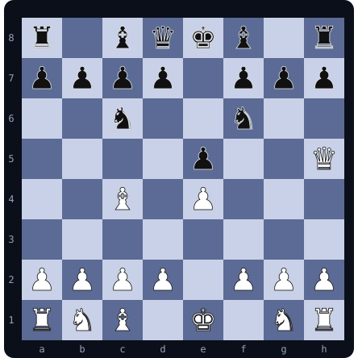

 

> 🎮 **You just loaded my save file.** Everything below is clickable. Poke around.

**Bored? Not sure where to start?** &nbsp; [**🎲 Let Jesus Decide**](https://Stfuyogesh.github.io/LETJESUSDECIDE) &nbsp; (yes, really)

---

## 🧙 Player Card

<table>
<tr>
<td width="50%" valign="top">

**Name:** Yogesh Singh
**Class:** CS & IT Student
**Level:** 2 *(2nd year)*
**Guild:** none yet, recruiting
**Main quest:** build weird things that work
**Side quest:** sleep *(failing)*
**Hobbies:** chess ♟️ · Formula 1 🏎️ · card games 🃏

</td>
<td width="50%" align="center">

</td>
</tr>
</table>

---

## ⚔️ Quest Log

### 🌌 Quest 1: Galaxy Collision
*Reward: watch two galaxies crash into each other, in 3D.*

<b>📜 Open quest details</b>

 

- **Goal:** an interactive 3D galaxy collision simulation using the Barnes-Hut algorithm
- **Gear:**  
- **Status:** 🟣 live

[**▶ Enter the simulation**](https://Stfuyogesh.github.io/Galaxy-Collision-An-Interactive-3D-Barnes-Hut-Simulation) · [source](https://github.com/Stfuyogesh/Galaxy-Collision-An-Interactive-3D-Barnes-Hut-Simulation)

### 🧠 Quest 2: Tiny Shakshphere GPT
*Reward: understanding how GPT and Claude work, by building a tiny one myself.*

<b>📜 Open quest details</b>

 

- **Goal:** a GPT-style transformer built from scratch (attention, multi-head attention, training loop), trained on Shakespeare
- **Gear:**  
- **Status:** 🟢 built, still experimenting

[**▶ View the code**](https://github.com/Stfuyogesh/Tiny-Shakshphere-Gpt)

### ✝️ Quest 3: Let Jesus Decide
*Reward: the cure for boredom.*

<b>📜 Open quest details</b>

 

- **Goal:** a website you open when you're bored and can't decide what to do
- **Gear:**   
- **Status:** 🟣 live

[**▶ Cure my boredom**](https://Stfuyogesh.github.io/LETJESUSDECIDE) · [source](https://github.com/Stfuyogesh/LETJESUSDECIDE)

### 🎵 Quest 4: Undertone
*Reward: a hidden layer you didn't know was there.*

<b>📜 Open quest details</b>

 

- **Goal:** (edit this line: one sentence on what Undertone does)
- **Gear:** 
- **Status:** 🟢 in progress

[**▶ View the code**](https://github.com/Stfuyogesh/UNDERTONE)

---

## 🏎️ Formula Yogesh

**🏁 Championship Standings** *(not actually FIA approved)*

| Pos | Project | Points |
|:-:|---|:-:|
| 🥇 P1 | [Galaxy Collision](https://Stfuyogesh.github.io/Galaxy-Collision-An-Interactive-3D-Barnes-Hut-Simulation) | 25 |
| 🥈 P2 | [Tiny Shakshphere GPT](https://github.com/Stfuyogesh/Tiny-Shakshphere-Gpt) | 18 |
| 🥉 P3 | [Let Jesus Decide](https://Stfuyogesh.github.io/LETJESUSDECIDE) | 15 |
| P4 | [Undertone](https://github.com/Stfuyogesh/UNDERTONE) | 12 |

---

## ♟️ Chess Corner

**White to move. Find the checkmate in 1.**

<b>👀 Reveal the answer</b>

 

**Qxf7#** 👑 The queen takes f7, the bishop on c4 protects her, and the king has nowhere to run. That's Scholar's Mate.

---

## 🃏 Pick a Card

*Pick any card. Your fate is one click away.*

<table>
<tr>
<td align="center" valign="top">

 <b>♠ Ace of Spades</b> Go watch galaxies collide. <a href="https://Stfuyogesh.github.io/Galaxy-Collision-An-Interactive-3D-Barnes-Hut-Simulation">▶ Play</a>

</td>
<td align="center" valign="top">

 <b>♥ Queen of Hearts</b> See a tiny brain learn Shakespeare. <a href="https://github.com/Stfuyogesh/Tiny-Shakshphere-Gpt">▶ Open</a>

</td>
<td align="center" valign="top">

 <b>🃏 The Joker</b> Let fate cure your boredom. <a href="https://Stfuyogesh.github.io/LETJESUSDECIDE">▶ Spin</a>

</td>
<td align="center" valign="top">

 <b>♣ King of Clubs</b> Find the hidden layer. <a href="https://github.com/Stfuyogesh/UNDERTONE">▶ Open</a>

</td>
</tr>
</table>

---

## 💬 Talk to the NPC

*Pick a dialogue option:*

🗨️ <b>"What are you building next?"</b>

 

> *"Something that makes people say 'wait, that actually works?' Vote below and help me pick."*

🗨️ <b>"Why galaxies, a tiny GPT, and Jesus?"</b>

 

> *"Because curiosity doesn't pick a lane. Space is big, AI is weird, and boredom is universal."*

🗨️ <b>"Can we team up?"</b>

 

> *"Yes. Hackathons, research, random experiments. Use the guild invite below."*

---

## 🗳️ Choose My Next Quest

Each button opens a pre-filled issue. Press **Submit** and your vote counts.

| | Quest | Vote |
|:-:|---|:-:|
| 🤖 | Robot swarm simulator | [**Vote**](https://github.com/Stfuyogesh/Stfuyogesh/issues/new?title=Vote:%20Robot%20swarm&body=I%20vote%20for%20the%20robot%20swarm%20simulator!) |
| 🎲 | Multiplayer browser game | [**Vote**](https://github.com/Stfuyogesh/Stfuyogesh/issues/new?title=Vote:%20Multiplayer%20game&body=I%20vote%20for%20a%20multiplayer%20game!) |
| 🔭 | Space data explorer | [**Vote**](https://github.com/Stfuyogesh/Stfuyogesh/issues/new?title=Vote:%20Space%20explorer&body=I%20vote%20for%20a%20space%20data%20explorer!) |

[**⚔️ Send me a quest**](https://github.com/Stfuyogesh/Stfuyogesh/issues/new?title=Quest:%20&body=Tell%20me%20your%20idea!) &nbsp;·&nbsp; [**📜 Sign the guestbook**](https://github.com/Stfuyogesh/Stfuyogesh/issues/new?title=Guestbook:%20Hi!&body=Leave%20a%20message!) &nbsp;·&nbsp; [**🛡️ Join my guild**](mailto:yogeshjhd@gmail.com)

---

## 🎒 Inventory

**⚔️ Weapons (languages)**

**🔮 Spells (data & ML)**

**🛡️ Armor (systems & tools)**

 

  

*"I have a life ❤️ "*

